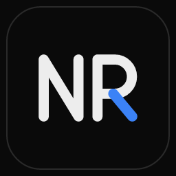
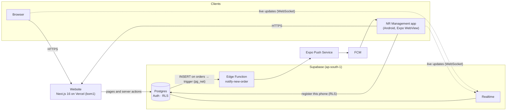

<div align="center">



# NR Management

**Order management for NR Industries, on the web and on Android, live in real time.**

[](https://super-management-system-tau.vercel.app)
[](#download-the-android-app)
[](https://nextjs.org)
[](https://react.dev)
[](https://supabase.com)
[](https://tailwindcss.com)
[](https://www.typescriptlang.org)
[](https://expo.dev)

</div>

Marketing punches transformer orders straight to the production team that
will build them. Production moves each order through five stages, and
administrators oversee everything. Everyone uses the same system, through
the website or the Android app, and every change shows up on every screen
within seconds.

---

## Download the Android app

**[Download NR-Management.apk](https://github.com/Himkush1414/Super-Management-System/releases/latest/download/NR-Management.apk)**
(always the newest version), or scan with the phone's camera:


1. Open the link on the Android phone and download the APK.
2. Open the file. If Android asks, allow installs from your browser, then tap **Install**
   (on a Play Protect warning: **More details → Install anyway**).
3. Open **NR Management** and sign in.

**A login is still required.** The app is the live website: only the
existing staff accounts (username + 6-digit PIN) can see anything. A newer
APK installs over the old one and keeps you signed in. For iPhone, see
[iOS](docs/ios.md).

---

## Features

From the code as it is today:

**Accounts and access**
- Sign-in with **username + 6-digit PIN**. No self sign-up and no
  password recovery. Fixed accounts only.
- PIN lockout: 5 wrong PINs in 15 minutes lock that username for 15
  minutes, with a separate per-IP cap. Checked inside Postgres.
- Role-based access for administrators, marketing and production,
  enforced in Postgres row-level security, not just in the UI.

**Orders**
- **Punch Order** (marketing): client, ship-to address, expected
  delivery, up to **20 products** (name, transformer rating, quantity,
  price, description), one additional amount, and the specific production
  members to send it to.
- **18% GST per product**, computed in the database. Subtotals are shown
  step by step.
- **Five stages**: Start, Mid, Testing, End of Production, Dispatch and
  Deliver. Production advances one step at a time, with a 3-minute timer
  between steps. Administrators can move an order to any stage.
- **Production never sees a price.** Prices, GST and amounts are dropped
  for that role on every page, export and notification.

**Live everywhere**
- **Supabase Realtime**: new orders, stage changes and notifications
  update every open screen within seconds, web and app alike.
- **Push notifications** (Android app): a new order alerts the phones of
  the production members it was sent to and of the administrators, even
  with the app closed. Tapping it opens the order.
  [Setup](docs/mobile-push-setup.md)

**Documents and records**
- **PDF**: an order specification sheet per order, and a *Download All
  Orders* report by week, month, year or all time, grouped and totalled.
- **CSV export**: one row per product, safe against spreadsheet formula
  injection.
- **Data management and activity log** (administrators): delete or reset
  with confirmation and an optional PDF archive first. Every delete is
  recorded in an append-only audit log.
- Dates are DD/MM/YYYY and times are IST everywhere. The dashboard has a
  dark/light theme switch.

**Android app**
- The live website in a locked-down WebView: HTTPS only, and only the
  website's and Supabase's domains open inside the app.
- Feels like an app, not a web page: no zoom, bounce or sideways drag, no
  tap flash or long-press menus. The splash stays until the page has
  painted, and the bars take the page's colour.
- Native screens for offline, server errors and slow loads, with
  **Retry** and automatic retries. Realtime reconnects immediately after
  the phone wakes.
- Back closes dialogs and the menu, then follows page history, then asks
  before leaving. PDF/CSV downloads open in the phone's viewer or share
  sheet (WhatsApp, Drive, print).

## Screenshots

> Placeholders. No real screenshots are committed yet. Add PNGs under
> `docs/assets/screenshots/` and replace the cells below.

| Sign in | Orders | Order detail | Android app |
|:---:|:---:|:---:|:---:|
| _placeholder: `login.png`_ | _placeholder: `orders.png`_ | _placeholder: `order.png`_ | _placeholder: `android.png`_ |

## Architecture



The website and the app share one backend, so they are always in sync.
There is no separate app API, no copy of the data on the phone, and no
polling.

## Tech stack

| Layer | What |
|---|---|
| Website | Next.js 16 (App Router, Turbopack), React 19, Tailwind CSS 4, TypeScript 5, framer-motion, lucide-react |
| Data | Supabase Postgres with row-level security, Supabase Auth (`@supabase/ssr` cookies), Supabase Realtime |
| Documents | `@react-pdf/renderer` (server-side PDFs), CSV |
| Hosting | Vercel, functions pinned to `bom1` next to the Mumbai database |
| Android app | Expo SDK 58, React Native 0.88, `react-native-webview`, `expo-notifications`, built on EAS |
| Push | Postgres trigger (pg_net) → Supabase Edge Function → Expo Push API → FCM / APNs |

## Project structure

```
app/, components/, lib/   the website (Next.js App Router)
proxy.ts                  session refresh + sign-in redirects
supabase/migrations/      the website's database schema (applied)
supabase/scripts/         one-off verify / snapshot / rollback scripts
supabase/mobile/          push: additive SQL + Edge Function (applied by hand)
mobile/                   the Android/iOS app (own package.json)
  App.js                  WebView, error screens, back button, keyboard, push wiring
  src/                    URL policy, page bridge, app feel, colours, downloads, push
  scripts/                logo, icons, QR code generators
  test/                   node tests (URL policy, page bridge, app feel, downloads, Edge Function)
.github/workflows/        manual EAS build (workflow_dispatch only)
docs/                     setup guides, handoff, website reference, images
```

## Environment variables

Names only. Values live in Vercel, EAS and Supabase, never in git.

| Where | Name | Notes |
|---|---|---|
| Website (Vercel) | `NEXT_PUBLIC_SUPABASE_URL`, `NEXT_PUBLIC_SUPABASE_ANON_KEY` | public |
| Website (Vercel) | `SUPABASE_SERVICE_ROLE_KEY` | server only |
| App (EAS, `preview`/`production`) | `EXPO_PUBLIC_SUPABASE_URL`, `EXPO_PUBLIC_SUPABASE_ANON_KEY` | public; to register for push (not set: push is dormant) |
| App (EAS) | `EXPO_PUBLIC_WEB_URL` | optional; defaults to the production URL |
| App (EAS, secret file) | `GOOGLE_SERVICES_JSON` | Firebase config; push is off without it |
| Edge Function | `NR_WEBHOOK_SECRET` (+ optional `EXPO_ACCESS_TOKEN`) | Supabase function secrets |
| GitHub Actions | `EXPO_TOKEN` | repository secret, for the manual build |

See `.env.example` and `mobile/.env.example`.

## Development

```bash
# website
npm install && npm run dev            # needs .env.local (see .env.example)

# app
cd mobile && npm install
npm run typecheck && npm run lint && npm test
npx expo start                        # with a development build
```

More detail on the website (accounts, pipeline, schema, exports):
[docs/website-reference.md](docs/website-reference.md).

> Note for edits under `mobile/`, `docs/`, `supabase/mobile/` and
> `.github/`: the website's Tailwind build scans every committed text
> file for class names, so a new word that happens to be a Tailwind
> utility adds an unused rule to the website's CSS. Compare the CSS
> output of `next build` with `master` before merging.

## Release process (Android)

1. Merge to `master`. The website deploys on Vercel as usual; the app
   needs nothing for website changes.
2. Only when the app itself changed: build with
   `cd mobile && npx eas-cli build -p android --profile production-apk`
   or with **Actions → Mobile · EAS Android build → Run workflow**.
   The versionCode goes up by itself and the same signing key is used,
   so the new APK installs over the old one.
3. Scan the APK for secrets, then publish it as a GitHub Release on the
   exact commit that was built, with the file named `NR-Management.apk`.
   The download link and QR code above then serve the new version by
   themselves. Exact commands: [docs/HANDOFF.md](docs/HANDOFF.md#releasing-a-new-apk).

Handoff, manual phone checklist and open items:
[docs/HANDOFF.md](docs/HANDOFF.md).

The Android signing key is kept by EAS. Back it up, because losing it
means phones can't update over the installed app. See
[docs/android-signing.md](docs/android-signing.md).

## Security notes

- The app uses the website's own sign-in, unchanged. It stores no
  usernames, PINs or passwords. Sign-out and session expiry behave
  exactly as on the website.
- HTTPS only (cleartext is disabled). Only the website's and Supabase's
  domains load inside the app, and other links open in the browser.
  WebView debugging is off in release builds.
- The app has only the public anon key. The service-role key exists only
  on the server (Vercel) and in Supabase.
- Push tokens are protected by RLS (each user sees only their own). The
  trigger sends only the order id, and notifications never contain prices.
- Database changes for the app are additive and applied by hand
  ([supabase/mobile/](supabase/mobile/)). The rollback only turns
  notifications off.
- Secrets are scanned with gitleaks before every push. `.env*`,
  keystores, `google-services.json` and service-account files are
  gitignored.
