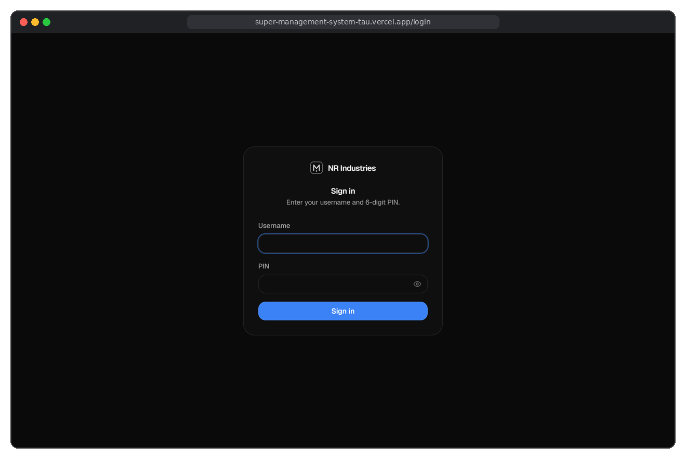
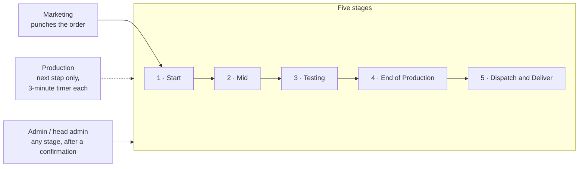
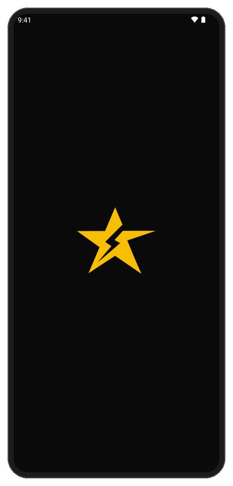
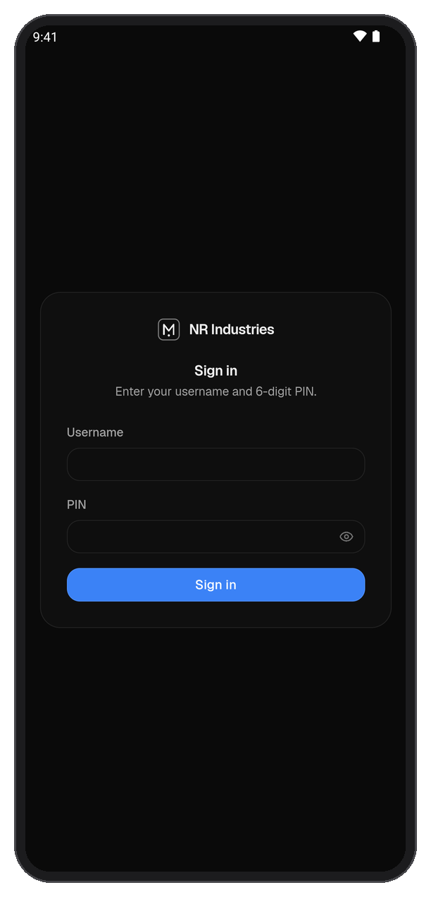
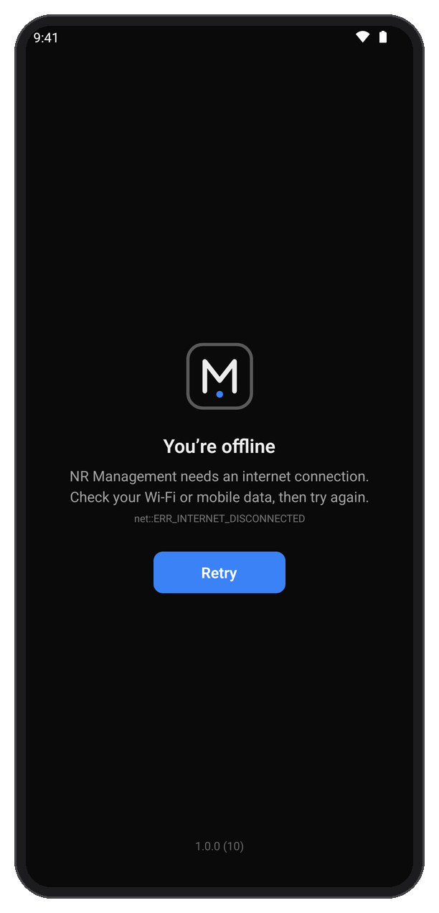
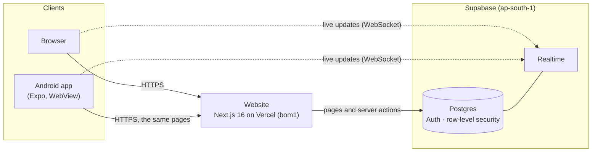

<div align="center">


# NR Management

**Orders and store inventory for NR Industries, on the web and on Android, live in real time.**

[](https://super-management-system-tau.vercel.app)
[](#android-app)
[](#what-it-is)
[](#license-and-rights)
<br>
[](https://nextjs.org)
[](https://react.dev)
[](https://www.typescriptlang.org)
[](https://tailwindcss.com)
[](https://supabase.com)
[](https://expo.dev)

</div>

<p align="center">
  
</p>

## Contents

| Use it | Understand it | Work on it |
|---|---|---|
| [What it is](#what-it-is) | [Roles and access](#roles-and-access) | [Getting started](#getting-started-developers) |
| [Features](#features) | [How an order moves](#how-an-order-moves) | [Project structure](#project-structure) |
| [Android app](#android-app) | [Architecture](#architecture) | [Testing](#testing) |
| [Screenshots](#screenshots) | [Tech stack](#tech-stack) | [Releasing](#releasing) |
| [Inventory module](docs/inventory/README.md) | [Security](#security) | [Backups](#backups) · [Roadmap](#roadmap) |

## What it is

- **Orders:** marketing punches transformer orders straight to the production team that will build them. Production moves each order through five stages, and administrators oversee everything.
- **Inventory:** the store keeps its stock on an append-only ledger (receive, issue, balance), with minimum-stock alerts, Party search and PDF / Word / Excel exports. See [docs/inventory/README.md](docs/inventory/README.md).
- **One system:** a Next.js website on Vercel with a Supabase database.
- **The Android app shows that same live website** in a native shell. It has the same sign-in (username + 6-digit PIN), the same pages and the same data.
- **Always in sync:** a change made on a phone appears on every computer within seconds, and the other way round. The app keeps no copy of the data, and website updates reach it without a new APK.

---

## Features

### Website

| Area | What it does |
|---|---|
| **Sign-in** | Username + 6-digit PIN. Fixed staff accounts only: no self sign-up, no password recovery. Repeated wrong PINs lock the username for a while, checked inside Postgres. |
| **Roles** | Head admin, admin, marketing, production and inventory, enforced by Postgres row-level security, not only by the screens ([table below](#roles-and-access)). |
| **Punch Order** (marketing) | Client, ship-to address, expected delivery, up to **20 products** (name, transformer rating, quantity, price, description), one additional amount, and the production members to send it to. |
| **Money** | 18% GST per product row, row = unit price × quantity (+ additional amount), added up in integer paise by one shared formula for every page, PDF and CSV. |
| **Five stages** | Start, Mid, Testing, End of Production, Dispatch and Deliver. Production advances one step at a time, with a 3-minute timer per step. Administrators can move an order to any stage. |
| **Prices hidden** | **Production never sees a price**, on any page, export or notification. |
| **Live updates** | Through Supabase Realtime: new orders, stage changes and notifications appear on every open screen within seconds. |
| **Documents** | An order specification PDF per order; a *Download All Orders* PDF by week, month, year or all time; a CSV export (one row per product, safe against spreadsheet formula injection). |
| **Administration** | Data management with confirmation and an optional PDF archive before a reset, and an append-only activity log. |
| **Inventory** | Store stock on an append-only ledger, minimum-stock alerts, Party search and PDF / Word / Excel exports: [docs/inventory/README.md](docs/inventory/README.md). |
| **Everywhere** | DD/MM/YYYY dates and IST times; a dark/light switch in the dashboard; text and buttons meet WCAG AA contrast in both themes. |

### Android app

- **Locked down:** the live website in a WebView, HTTPS only. Only the website's own address opens inside the app; other links open in the phone's own apps.
- **Feels like an app:** no zoom, bounce or sideways page drag, no tap flash or long-press menus. The status and navigation bars take the page's colour and follow the dark/light switch.
- **Recovers by itself:** native screens for offline, server errors and slow pages, each with **Retry**.
  - Server errors retry by themselves after 10, 20 and 40 s.
  - A stuck page is reloaded once by itself.
  - Realtime reconnects as soon as the phone wakes.
- **Back button:** Android back closes a dialog or the menu first, then goes back, then asks before leaving.
- **Downloads:** PDF, CSV, Word and Excel files open in the phone's viewer or share sheet (WhatsApp, Drive, print).
- **Stays signed in:** signing in survives killing the app right afterwards.
- **Diagnostics:** a hidden screen (page timings only, no data) for slow-page reports. See [docs/HANDOFF.md](docs/HANDOFF.md#diagnostics-when-a-page-is-slow).

## Roles and access

Every account is fixed and signs in with username + 6-digit PIN. The same rules are checked on the screen, in every server action and route (`lib/permissions.ts`), and by **Postgres row-level security**.

| Can… | Head admin | Admin | Marketing | Production | Inventory |
|---|:---:|:---:|:---:|:---:|:---:|
| Punch an order | — | — | ✅ | — | — |
| See orders | all | all | own | assigned to them | — |
| Advance a stage (one step, 3-minute timer) | — | — | — | ✅ | — |
| Move any order to any stage | ✅ | ✅ | — | — | — |
| See prices | ✅ | ✅ | own orders | **never** | — |
| Settings: real name | — | — | ✅ | ✅ | — |
| Settings: WhatsApp number | — | — | — | ✅ | — |
| Data management (delete, reset, all logged) | ✅ | ✅ | — | — | — |
| Activity log | ✅ | ✅ except head admin's own entries | — | — | — |
| Inventory: stock, history, alerts, Party search, exports | read-only | read-only | — | — | ✅ |
| Inventory: receive, issue, reverse, products, settings | — | — | — | — | ✅ |
| Inventory: trend, top 10, past months | ✅ | ✅ | — | — | — |

The inventory account sees only the Inventory module.

## How an order moves



Everyone with access sees each step within seconds (Realtime). Production never sees the price.

## Android app

- **Private:** the owner hands the app to staff privately. There is no public download link, store listing or GitHub Release, on purpose: the repository is public, and the app is only for the staff.
- **A login is still required:** the app is the live website, so only the existing staff accounts (username + 6-digit PIN) can see anything.
- **Updates:** a newer APK installs over the old one and keeps you signed in.
- **iPhone:** see [iOS](docs/ios.md).

## Screenshots

Only screens without any data are shown here: the app's start, sign-in and offline screens, taken on an Android emulator without signing in. The Inventory module's page shows [screens with fake sample data](docs/inventory/README.md).

<table>
  <tr>
    <td align="center" width="33%"><br><sub><b>Start</b>: the splash stays until the page has painted</sub></td>
    <td align="center" width="33%"><br><sub><b>Sign in</b>: the website's own page, username + PIN</sub></td>
    <td align="center" width="33%"><br><sub><b>Offline</b>: a native screen, retries by itself</sub></td>
  </tr>
</table>

## Architecture



- The browser and the app load the same website and share one backend, so they are always in sync.
- There is no separate app API, no copy of the data on the phone, and no polling.

## Tech stack

Checked against `package.json` and `mobile/package.json`.

| Layer | What |
|---|---|
| Website | Next.js 16 (App Router, Turbopack), React 19, TypeScript 5, Tailwind CSS 4, framer-motion, lucide-react |
| Data | Supabase Postgres with row-level security, Supabase Auth (`@supabase/ssr` cookies), Supabase Realtime |
| Documents | `@react-pdf/renderer` (PDFs on the server), CSV; Word and Excel written by the app itself (no extra package) |
| Hosting | Vercel, functions pinned to `bom1` next to the Mumbai database |
| Android app | Expo SDK 58, React Native 0.88, React 19, `react-native-webview` 14, built and signed on EAS |
| Checks | ESLint, TypeScript, `node --test` (app and SQL on PGlite), `next build`, gitleaks secret scan on every push |

## Getting started (developers)

```bash
# website
npm ci
cp .env.example .env.local      # then fill in the values (names below)
npm run dev                     # http://localhost:3000
npm run lint && npx tsc --noEmit && npm test && npm run build

# Android app
cd mobile
npm ci
npm run typecheck && npm run lint && npm test
npx expo start                  # with a development build
```

Environment variables, **names only** (values live in Vercel, EAS and Supabase, never in git):

| Where | Name | Notes |
|---|---|---|
| Website | `NEXT_PUBLIC_SUPABASE_URL`, `NEXT_PUBLIC_SUPABASE_ANON_KEY` | public |
| Website | `SUPABASE_SERVICE_ROLE_KEY` | server only |
| Inventory scripts | `SUPABASE_ACCESS_TOKEN`, `SUPABASE_PROJECT_REF`, `INVENTORY_*` | shell or `.env.local` only; see [scripts/inventory](scripts/inventory/README.md) |
| App (EAS) | `EXPO_PUBLIC_WEB_URL` | optional; defaults to the live website |
| App (EAS, push, not set) | `EXPO_PUBLIC_SUPABASE_URL`, `EXPO_PUBLIC_SUPABASE_ANON_KEY`, `GOOGLE_SERVICES_JSON` | only for push notifications, which are off |
| GitHub Actions | `EXPO_TOKEN` | for the manual app build |

See `.env.example` and `mobile/.env.example`.

> **For edits outside the website code** (`mobile/`, `docs/`, `.github/`,
> `supabase/`): the website's Tailwind build scans every committed text
> file for class names, so a new word that happens to be a Tailwind
> utility adds an unused rule to the website's CSS. Compare the CSS of
> `next build` with `master` before merging.

## Project structure

```
app/, components/, lib/   the website (Next.js App Router)
proxy.ts                  session refresh and sign-in redirects
types/                    database types
supabase/migrations/      the database schema (applied to live)
supabase/scripts/         read-only verify and snapshot scripts
scripts/db-backup.sh      read-only database backup, written outside the repo
scripts/inventory/        inventory import, account and read-only backup scripts
supabase/mobile/          push notifications: SQL + Edge Function (not applied)
tests/                    website tests; tests/sql runs every migration on PGlite
mobile/                   the Android app (its own package.json)
  App.js                  WebView, error screens, back button, keyboard, downloads
  src/                    URL policy, page bridge, loading watchdog, app feel, colours
  test/                   node tests
  scripts/                icon and splash generators
.github/workflows/        website checks, secret scan (every push), manual EAS app build
docs/                     handoff, security, data safety, setup guides, images
docs/inventory/           inventory module, store guide, plain-language walkthrough, backup
```

## Testing

| Suite | Command | What it proves |
|---|---|---|
| Website, unit | `npm test` | time limits on database requests, the role matrix in code, the inventory maths (exact quantities, rollover, reversal, double submit), search, export ranges, low-stock and party rules |
| Database | `npm test` (`tests/sql/`) | every migration on a real Postgres 17 (PGlite): row-level security per role, append-only guards, ledger and rollover rules, field validation, backup and restore |
| Android app | `cd mobile && npm test` | URL policy, page bridge, downloads, loading watchdog, app feel, colours |
| CI, every pull request | GitHub Actions | lint, typecheck, `npm test`, `next build`, gitleaks |

Browser checks also run locally against a fake Supabase with fake data before a merge. They cover the role matrix on every page, the main flows, layout at 360 / 390 / 768 / 1024 / 1440 px, an accessibility scan (axe, WCAG AA) and downloads through the Android app's bridge.

## Releasing

- **Website:** every push to `master` deploys on Vercel. Commits must be authored by `nrindustry`, or Vercel blocks the deployment.
- **Android app:** only when `mobile/` changed.
  1. Build the `production-apk` profile on EAS (same signing key; the versionCode goes up by itself).
  2. Scan the APK for secrets.
  3. Give it to staff privately. It is never published on GitHub.

  Exact steps: [docs/HANDOFF.md](docs/HANDOFF.md#releasing-a-new-apk). Signing key: [docs/android-signing.md](docs/android-signing.md).

## Security

- **Sign-in:** the app uses the website's own sign-in, unchanged, and stores no usernames, PINs or passwords. PIN lockout is checked inside Postgres.
- **Keys:** the browser and the app only ever have the public anon key; the service-role key exists only on the server (Vercel) and in Supabase.
- **Database:** row-level security on every table, so each role reads and changes only what it may. Inventory writes go only through role-checked functions; its history is append-only and never hard-deleted.
- **Transport:** HTTPS only, with security headers (Content-Security-Policy, no framing). The WebView blocks cleartext, mixed content, file access and extra windows, and debugging is off in release builds.
- **Repository:**
  - Every push and pull request runs a gitleaks secret scan, and GitHub push protection refuses known token formats.
  - `.env*`, signing keys, Firebase and service-account files, dumps, backups and APKs are gitignored.
  - Only fake sample data appears in tests and screenshots.
- **More:** secrets and how to rotate them in [docs/SECURITY.md](docs/SECURITY.md); the rules for changing data in [docs/DATA-SAFETY.md](docs/DATA-SAFETY.md).

## Backups

| What | How | Restore |
|---|---|---|
| Whole database (roles, schema, data) | `scripts/db-backup.sh`, read-only, written outside the repo | [docs/DATA-SAFETY.md](docs/DATA-SAFETY.md) |
| Inventory tables only | `node scripts/inventory/backup.mjs`, read-only, to `D:\NR-Backups\inventory` | [docs/inventory/BACKUP.md](docs/inventory/BACKUP.md) |
| Supabase's own | depends on the plan (Dashboard → Database → Backups) | [docs/DATA-SAFETY.md](docs/DATA-SAFETY.md#backups) |

**Never restore over the live database:** restore into a new project first.

## Roadmap

Honest status; nothing here is promised by a date.

- [x] Website: orders, stages, roles, PDFs, CSV, realtime, dark/light
- [x] Android app: native shell, error screens, downloads, loading watchdog
- [x] Inventory: ledger, rollover, minimum-stock alerts, Party search, PDF / Word / Excel
- [ ] Faster tab switches on slow connections: a time limit on database
      reads and a "Try again" page (proposal waiting for review in PR #15)
- [ ] Push notifications for new orders (code ready, needs Firebase and
      the SQL applied; see [docs/mobile-push-setup.md](docs/mobile-push-setup.md))
- [ ] Google Play listing (see [docs/HANDOFF.md](docs/HANDOFF.md#later-optional))
- [ ] iPhone app (see [docs/ios.md](docs/ios.md))

## License and rights

There is no open-source license. All rights are reserved by the owner of
this repository: the code is visible on GitHub, but it may not be copied,
used or redistributed without written permission.
