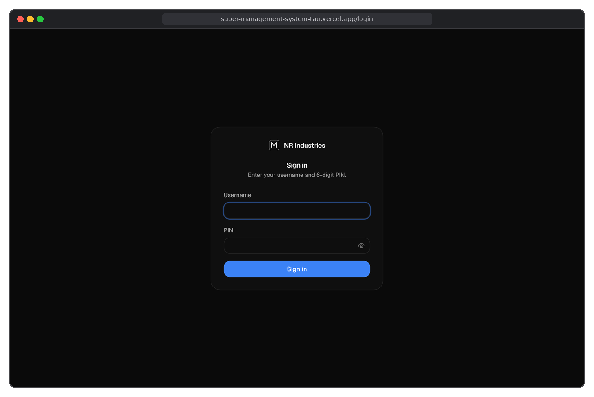
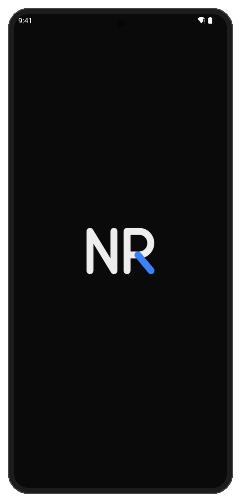
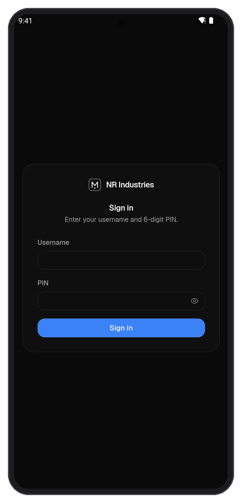
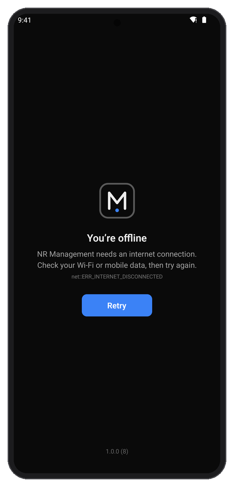
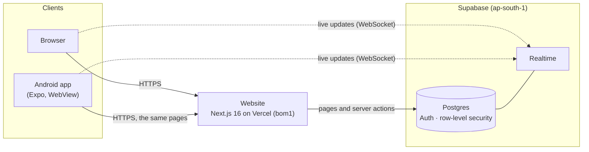

<div align="center">


# NR Management

**Order management for NR Industries, on the web and on Android, live in real time.**

[](https://super-management-system-tau.vercel.app)
[](#download-the-android-app)
[](#what-it-is)
[](#license-and-rights)
<br>
[](https://nextjs.org)
[](https://react.dev)
[](https://www.typescriptlang.org)
[](https://tailwindcss.com)
[](https://supabase.com)
[](https://expo.dev)

</div>

<p align="center">
  
</p>

## What it is

Marketing punches transformer orders straight to the production team that
will build them. Production moves each order through five stages, and
administrators oversee everything.

There is **one system**: a Next.js website on Vercel with a Supabase
database. The **Android app shows that same live website** in a native
shell, so it always has the same sign-in (username + 6-digit PIN), the
same pages and the same data. A change made on a phone appears on every
computer within seconds, and the other way round. The app keeps no copy
of the data, and website updates reach it without a new APK.

---

## Download the Android app

**[Download NR-Management.apk](https://github.com/Himkush1414/Super-Management-System/releases/latest/download/NR-Management.apk)**
(always the newest version), or scan with the phone's camera:


1. Open the link on the Android phone and download the APK.
2. Open the file. If Android asks, allow installs from your browser, then tap **Install**
   (on a Play Protect warning: **More details → Install anyway**).
3. Open **NR Management** and sign in.

**A login is still required.** The app is the live website: only the
existing staff accounts (username + 6-digit PIN) can see anything. A newer
APK installs over the old one and keeps you signed in. For iPhone, see
[iOS](docs/ios.md).

---

## Screenshots

Only screens without any data are shown here: the app's start, sign-in and
offline screens, taken on an Android emulator without signing in.

<table>
  <tr>
    <td align="center" width="33%"><br><sub><b>Start</b>: the splash stays until the page has painted</sub></td>
    <td align="center" width="33%"><br><sub><b>Sign in</b>: the website's own page, username + PIN</sub></td>
    <td align="center" width="33%"><br><sub><b>Offline</b>: a native screen, retries by itself</sub></td>
  </tr>
</table>

## Features

**Website**
- **Sign-in** with username + 6-digit PIN. Fixed staff accounts only: no
  self sign-up, no password recovery. 5 wrong PINs in 15 minutes lock that
  username for 15 minutes, with a separate per-IP cap, checked inside
  Postgres.
- **Roles**: head admin, admin, marketing and production, enforced by
  Postgres row-level security, not only by the screens.
- **Punch Order** (marketing): client, ship-to address, expected delivery,
  up to **20 products** (name, transformer rating, quantity, price,
  description), one additional amount, and the production members to
  send it to.
- **Money**: 18% GST per product row, row = unit price × quantity
  (+ additional amount), added up in integer paise by one shared formula
  for every page, PDF and CSV.
- **Five stages**: Start, Mid, Testing, End of Production, Dispatch and
  Deliver. Production advances one step at a time, with a 3-minute timer
  per step. Administrators can move an order to any stage.
- **Production never sees a price**, on any page, export or notification.
- **Live updates** through Supabase Realtime: new orders, stage changes and
  notifications appear on every open screen within seconds.
- **Documents**: an order specification PDF per order; a *Download All
  Orders* PDF by week, month, year or all time; a CSV export (one row per
  product, safe against spreadsheet formula injection).
- **Administration**: data management with confirmation and an optional
  PDF archive before a reset, and an append-only activity log.
- DD/MM/YYYY dates and IST times everywhere; a dark/light switch in the
  dashboard.

**Android app**
- The live website in a locked-down WebView: HTTPS only; only the
  website's own address opens inside the app, other links open in the
  phone's own apps.
- Feels like an app: no zoom, bounce or sideways page drag, no tap flash
  or long-press menus. The status and navigation bars take the page's
  colour and follow the dark/light switch.
- Native screens for offline, server errors and slow pages, each with
  **Retry**. Server errors retry by themselves after 10, 20 and 40 s; a
  stuck page is reloaded once by itself. Realtime reconnects as soon as
  the phone wakes.
- Android back closes a dialog or the menu first, then goes back, then
  asks before leaving.
- PDF and CSV downloads open in the phone's viewer or share sheet
  (WhatsApp, Drive, print).
- Signing in survives killing the app right afterwards.
- A hidden Diagnostics screen (page timings only, no data) for slow-page
  reports. See [docs/HANDOFF.md](docs/HANDOFF.md#diagnostics-when-a-page-is-slow).

## Architecture



The browser and the app load the same website and share one backend, so
they are always in sync. There is no separate app API, no copy of the data
on the phone, and no polling.

## Tech stack

Checked against `package.json` and `mobile/package.json`.

| Layer | What |
|---|---|
| Website | Next.js 16 (App Router, Turbopack), React 19, TypeScript 5, Tailwind CSS 4, framer-motion, lucide-react |
| Data | Supabase Postgres with row-level security, Supabase Auth (`@supabase/ssr` cookies), Supabase Realtime |
| Documents | `@react-pdf/renderer` (PDFs on the server), CSV |
| Hosting | Vercel, functions pinned to `bom1` next to the Mumbai database |
| Android app | Expo SDK 58, React Native 0.88, React 19, `react-native-webview` 14, built and signed on EAS |
| Checks | ESLint, TypeScript, `node --test` (app), gitleaks secret scan on every push |

## Getting started (developers)

```bash
# website
npm ci
cp .env.example .env.local      # then fill in the values (names below)
npm run dev                     # http://localhost:3000
npm run lint && npx tsc --noEmit && npm run build

# Android app
cd mobile
npm ci
npm run typecheck && npm run lint && npm test
npx expo start                  # with a development build
```

Environment variables, **names only** (values live in Vercel, EAS and
Supabase, never in git):

| Where | Name | Notes |
|---|---|---|
| Website | `NEXT_PUBLIC_SUPABASE_URL`, `NEXT_PUBLIC_SUPABASE_ANON_KEY` | public |
| Website | `SUPABASE_SERVICE_ROLE_KEY` | server only |
| App (EAS) | `EXPO_PUBLIC_WEB_URL` | optional; defaults to the live website |
| App (EAS, push, not set) | `EXPO_PUBLIC_SUPABASE_URL`, `EXPO_PUBLIC_SUPABASE_ANON_KEY`, `GOOGLE_SERVICES_JSON` | only for push notifications, which are off |
| GitHub Actions | `EXPO_TOKEN` | for the manual app build |

See `.env.example` and `mobile/.env.example`. Accounts, the order
pipeline, schema and exports in detail:
[docs/website-reference.md](docs/website-reference.md).

> **For edits outside the website code** (`mobile/`, `docs/`, `.github/`,
> `supabase/`): the website's Tailwind build scans every committed text
> file for class names, so a new word that happens to be a Tailwind
> utility adds an unused rule to the website's CSS. Compare the CSS of
> `next build` with `master` before merging.

## Project structure

```
app/, components/, lib/   the website (Next.js App Router)
proxy.ts                  session refresh and sign-in redirects
types/                    database types
supabase/migrations/      the database schema (applied to live)
supabase/scripts/         verify, snapshot and rollback scripts (no data)
supabase/mobile/          push notifications: SQL + Edge Function (not applied)
mobile/                   the Android app (its own package.json)
  App.js                  WebView, error screens, back button, keyboard, downloads
  src/                    URL policy, page bridge, loading watchdog, app feel, colours
  test/                   node tests
  scripts/                icon, splash and QR code generators
.github/workflows/        secret scan (every push), manual EAS app build
docs/                     handoff, setup guides, website reference, images
```

## Releasing

- **Website:** every push to `master` deploys on Vercel. Commits must be
  authored by `nrindustry`, or Vercel blocks the deployment.
- **Android app:** only when `mobile/` changed. Build the
  `production-apk` profile on EAS (same signing key, the versionCode goes
  up by itself), scan the APK for secrets, and publish it as a GitHub
  Release named `NR-Management.apk`. The download link and QR code above
  then serve it by themselves. Exact steps:
  [docs/HANDOFF.md](docs/HANDOFF.md#releasing-a-new-apk). Signing key:
  [docs/android-signing.md](docs/android-signing.md).

## Security

- The app uses the website's own sign-in, unchanged, and stores no
  usernames, PINs or passwords.
- The browser and the app only ever have the public anon key; the
  service-role key exists only on the server (Vercel) and in Supabase.
- HTTPS only; the WebView blocks cleartext, mixed content, file access and
  extra windows, and debugging is off in release builds.
- Every push and pull request runs a gitleaks secret scan, and GitHub push
  protection refuses known token formats. `.env*`, signing keys, Firebase
  and service-account files, dumps and APKs are gitignored.

## Roadmap

Honest status; nothing here is promised by a date.

- [x] Website: orders, stages, roles, PDFs, CSV, realtime, dark/light
- [x] Android app: native shell, error screens, downloads, loading watchdog
- [ ] Faster tab switches on slow connections: a time limit on database
      reads and a "Try again" page (proposal waiting for review in PR #15)
- [ ] Push notifications for new orders (code ready, needs Firebase and
      the SQL applied; see [docs/mobile-push-setup.md](docs/mobile-push-setup.md))
- [ ] Google Play listing (see [docs/HANDOFF.md](docs/HANDOFF.md#later-optional))
- [ ] iPhone app (see [docs/ios.md](docs/ios.md))

## License and rights

There is no open-source license. All rights are reserved by the owner of
this repository: the code is visible on GitHub, but it may not be copied,
used or redistributed without written permission.
