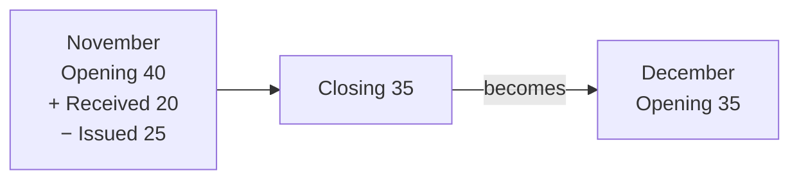
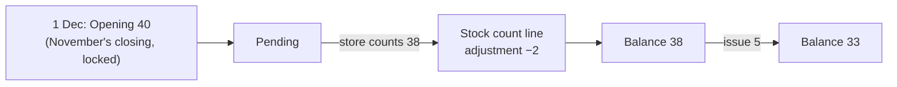

# How the inventory works, in plain words

A short explanation to give the client. It covers four ideas: the
**ledger**, the **month rollover**, the **month-start balance** and the
**low-stock alert**. All numbers are made up.

---

## 1. The ledger: a stock register that is never rubbed out

Think of the old paper stock register. Every time material comes in or goes
out, a new line is written. Nobody tears out a page or overwrites a line.
The system works the same way.

- Each **receipt** or **issue** is one line (an *entry*), with its date, quantity,
  who saved it, and details such as party, challan and bill, or job number.
- An entry can **never be edited or deleted**, not by the store person and not
  by an admin. The database itself refuses it, whatever screen or tool is used.
- Products are **archived**, not deleted. The only exception: a product added by mistake that has
  **no history at all** (no entry, no count, no closed month) can be deleted from the Archive tab,
  after typing its serial; a full copy is kept in the database. Anything with history can only be restored.
- A mistake is fixed the way an accountant does it: a **reversal**, a new line
  that cancels the wrong one. Both lines stay, so the history always shows what happened.
- The balance is **never typed over**. It is always calculated from the lines:

> **Balance = Opening + Received − Issued** (until November 2026)
>
> **Balance = Opening + Adjustment + Received − Issued** (from December 2026: the
> Adjustment comes from the store's month-start count, section 3)

### Example: product ZZ-005 in November

| Date | Entry | Qty | Balance after |
|---|---|---:|---:|
| 1 Nov | Opening (October's closing) | | 40 |
| 3 Nov | Received from Alpha Dummy Traders, challan CH-11 | +20 | 60 |
| 9 Nov | Issued for job J-7 | −25 | 35 |
| 9 Nov | Issued for job J-8 (typed 52 by mistake) | −52 | *refused: only 35 in stock* |
| 9 Nov | Issued for job J-8 | −5 | 30 |
| 10 Nov | **Reverse** of 9 Nov J-8 (wrong product) | +5 | 35 |

November so far: Opening 40, Received 20, Issued 25 (30 issued, 5 reversed), **Balance 35**.

Built-in safety:
- **You can't issue more than you have.** The database checks the balance at the moment of saving.
- **A double tap saves once.** Every save carries a unique key, so a repeated tap or a retried request is recognised and not saved twice.
- **Numbers are exact.** Quantities keep 3 decimals and money 2 decimals, with no rounding drift. Money is shown the Indian way: ₹1,23,456.00.

## 2. Month rollover: closing the books every month

At the end of every month, the system closes the books by itself.

- The **first time anyone opens Inventory in a new month**, the system writes down, for every product,
  last month's **opening, received, issued and closing**, and marks the month **closed**.
- The new month's **opening = last month's closing**. Always, automatically.
- A **closed month can't change**: entries can only be dated in the current month (never in the future).
  So November's report printed in January shows exactly what it showed on 1 December.
  *Tip: record every entry before the month ends.*
- If nobody opens the module for a while, say three months, all three months are closed in order
  the next time someone opens it, each one starting from the previous month's closing.
- Admins can pick any closed month and see its figures. Exports for any dates work the same way.
- Months up to November 2026 are closed exactly as before. From December 2026 each closed month
  also keeps its **Adjustment** and whether each balance was counted.

## 3. Month-start balance: counting the shelf on the 1st

From **1 December 2026**, the store counts every product at the start of each month and types
what is really on the shelf. The difference with the books becomes an **Adjustment** line.

- On the 1st, the **Opening** is still last month's closing and is **locked**.
- Every active product is **Pending** until its balance is entered. The screen says
  *"N products need balance"* and *"120 of 287 confirmed"*; Balance shows **Pending**.
- The count is saved as a new **Stock count** line (never an overwrite):
  **adjustment = counted − opening**, with who saved it and when. Equal numbers give an adjustment of 0.
- Counting again later in the month adds **another** stock count line with its own adjustment.
- A **Pending** balance is never shown as if it were real: it is left out of the stock value,
  the out-of-stock count and the low-stock alert, and exports print **Pending**.
- Receiving or issuing a Pending product first asks for the counted balance; both are saved together.
- Products added during the month are confirmed when they are added.
- You still **can't issue more than you have**, now counting the adjustment too.

### Example: product ZZ-005 in December

| Date | Line | Qty | Balance after |
|---|---|---:|---:|
| 1 Dec | Opening (November's closing) | | 40 |
| 1 Dec | **Stock count**: counted 38 | −2 | 38 |
| 4 Dec | Issued for job J-12 | −5 | 33 |
| 10 Dec | Received from Beta Sample Supplies | +10 | 43 |

December: Opening 40, Adjustment −2, Received 10, Issued 5, **Balance 43** (40 − 2 + 10 − 5).

### Counting from a document

If the counted balances are already in a file (PDF with text, Word, Excel or CSV), the store can
**import** it instead of typing: the phone reads the file itself (it is never uploaded or kept),
shows what it found, and only after a confirmation saves each balance as a normal **Stock count**
line. Rows it isn't sure about (no serial, the same serial twice, an empty or negative number) are
shown for review and never guessed. Scans and photos can't be read.

## 4. Low-stock alert: knowing when to reorder

- The store sets a **minimum stock** for each product that matters (for example: keep at least 30 of ZZ-005).
  Products without a minimum never raise an alert.
- A product is **low** when its balance is **below** the minimum:

| Minimum | Balance | Shown as |
|---:|---:|---|
| none | 2 | normal (no minimum, no alert) |
| 30 | 35 | normal |
| 30 | 30 | normal (equal is not low) |
| 30 | 29 | **Low**, shortfall 1 |
| 30 | 0 | **Low, Out of stock**, shortfall 30 |

- At the top of the page a box says **"N items below minimum, order advised"**. It opens the
  **Low Stock** list: balance, minimum, how many are short, and the **last party and date it was
  received from**, so you know whom to call.
- When an issue would take a product below its minimum, the store person gets a **warning before
  confirming**. It is a warning, not a block: production may need the material now.
- The alert **follows the live balance**: once enough stock is received, it disappears by itself.
- A product whose month-start balance is still **Pending** never raises the alert: its balance isn't known yet.
- Admins see the same alert and list (read-only) and a **Low stock** card on their screen.

## Who can do what

| | Store person (inventory) | Admin / head admin | Marketing, production |
|---|:---:|:---:|:---:|
| See stock, history, alerts, Party search | ✅ | ✅ read-only | — |
| Receive, issue, reverse | ✅ | — | — |
| Enter month-start balances (stock count) | ✅ | sees the Pending count, read-only | — |
| Products, minimums, settings | ✅ | — | — |
| Archive tab: restore; delete a product added by mistake (no history) | ✅ | sees it, read-only | — |
| Import from document | ✅ | — | — |
| Exports (PDF, Word, Excel) | ✅ | ✅ | — |
| Trends, top 10 issued, past months | — | ✅ | — |

The rules are checked by the database itself, not only by the screens.

## Backups

The inventory tables can be copied to a file on the office computer at any time, without
changing anything: see [BACKUP.md](BACKUP.md). Supabase's own backups depend on the plan
(the free plan has none): see [DATA-SAFETY.md](../DATA-SAFETY.md#backups).
