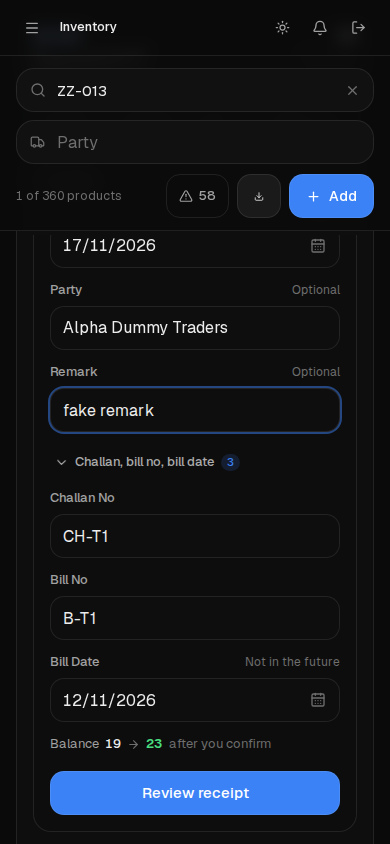
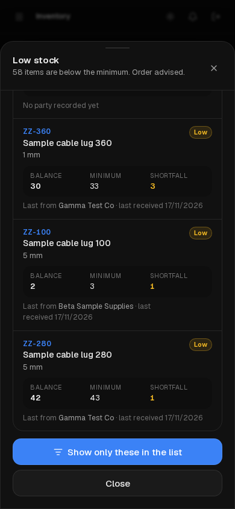
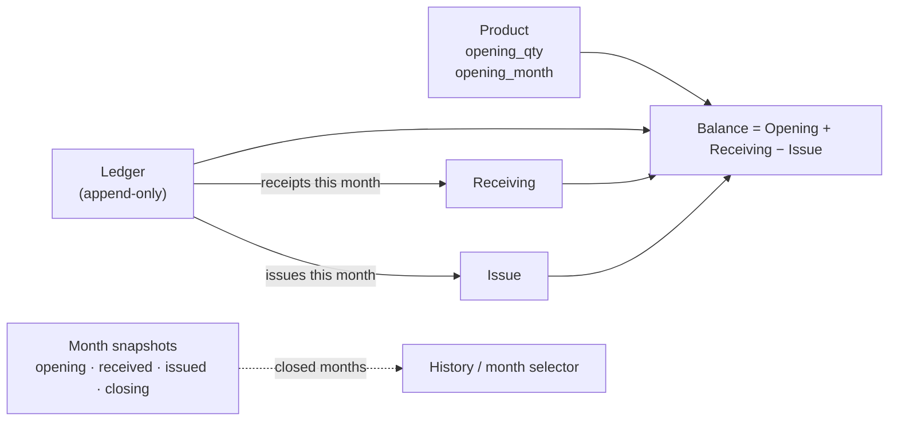
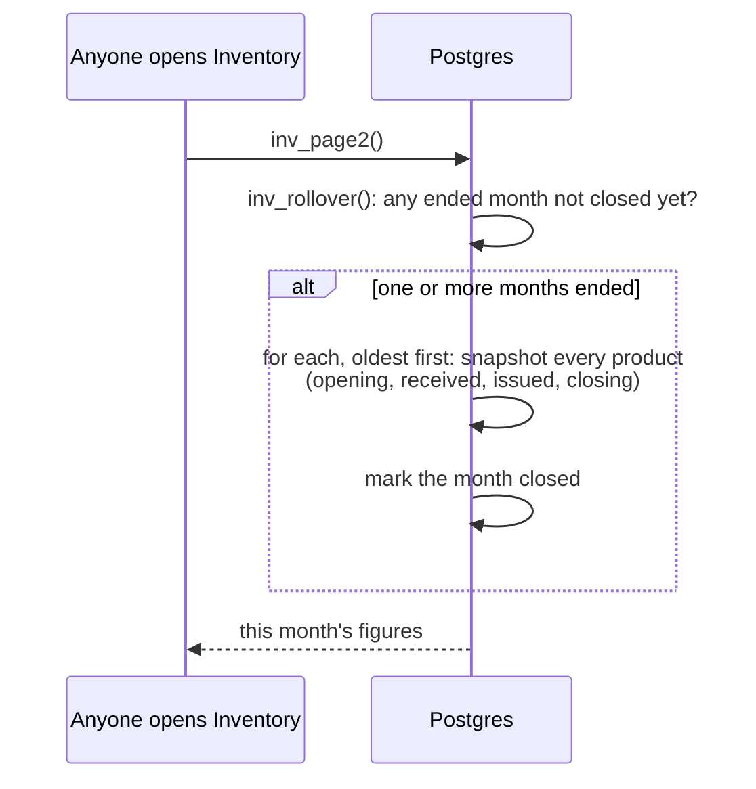
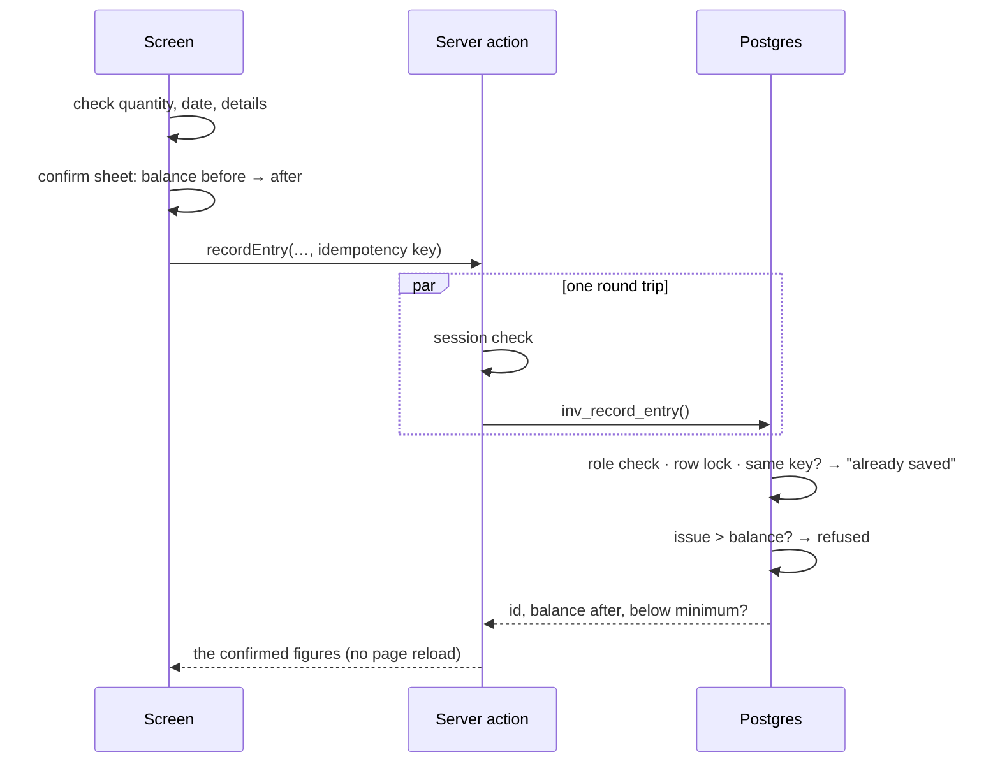
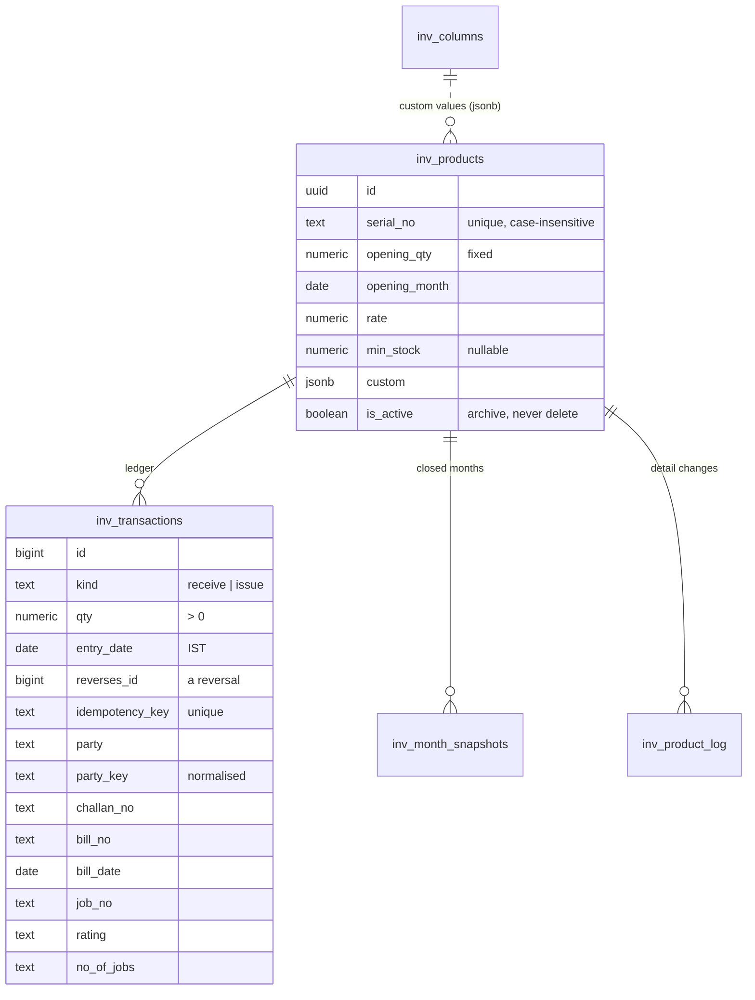

<div align="center">

# Inventory module

**Store stock on an append-only ledger: receive, issue, balance, minimum-stock alerts, Party search and exports.**

Part of [NR Management](../../README.md) · Next.js 16 · Supabase Postgres with row-level security · works inside the Android app

</div>

<p align="center">
  
</p>

<sub>Every screenshot on this page was taken from a local copy with **fake sample data** (serials like ZZ-001, made-up party names). No real product, party or quantity appears anywhere in this repository.</sub>

---

## Contents

- [What it does](#what-it-does)
- [Roles and access](#roles-and-access)
- [How the numbers work](#how-the-numbers-work)
- [Receive and issue](#receive-and-issue)
- [Minimum stock alert](#minimum-stock-alert)
- [Party search](#party-search)
- [Exports](#exports)
- [Speed](#speed)
- [Data model](#data-model)
- [Setup](#setup)
- [Security](#security)
- [Testing](#testing)

## What it does

| | |
|---|---|
| **Stock table** | Serial No, Material Description, Specification, Rate, Opening Balance, Receiving, Issue, Balance, plus the store's own columns. Cards on phones, an expandable table from 768 px. |
| **Instant search** | Every product, case-insensitive, extra spaces ignored, matches highlighted, under 100 ms per keystroke. |
| **Receive / Issue** | Quantity, date and the entry's details, then a confirm step showing the balance before and after. One tap saves once, even on a double tap or a retried request. |
| **History** | Each product's recent entries with their details; a mistake is fixed with **Reverse**, never by editing or deleting. |
| **Minimum stock** | An optional minimum per product; an alert box and a Low Stock list when the balance drops below it. |
| **Party search** | A second search field: the products received from a party (all months), with the quantity and the last challan, bill and date. |
| **Exports** | PDF, Word and Excel for this week, this month, the previous month, all time or any dates. |
| **Settings** | The inventory person, custom columns (add, rename, reorder, show / hide, archive) and minimum stock in bulk. |
| **Admin view** | head_admin and admin see everything read-only, plus a 6-month trend, the month's top 10 issued and a month selector. |

<table>
  <tr>
    <td align="center" width="25%"><br><sub>Phone: the stock list</sub></td>
    <td align="center" width="25%"><br><sub>Receive with its details</sub></td>
    <td align="center" width="25%"><br><sub>History with the details</sub></td>
    <td align="center" width="25%"><br><sub>The Low Stock list</sub></td>
  </tr>
</table>

## Roles and access

| | inventory | head_admin, admin | marketing, production |
|---|:---:|:---:|:---:|
| Open the Inventory module | ✅ (only this module) | ✅ read-only | — |
| Receive, issue, reverse | ✅ | — | — |
| Add, edit, archive products; minimums | ✅ | — | — |
| Inventory settings | ✅ | — | — |
| Alert box, Low Stock list, Party search, history | ✅ | ✅ | — |
| Trend, top 10, month selector | — | ✅ | — |
| Exports (PDF, Word, Excel) | ✅ | ✅ | — |

The same rule is enforced three times: the screen, every server action and route (`requireSession` + the permission matrix in `lib/permissions.ts`), and **Postgres row-level security** with role-checked functions. The UI is never the gate. The inventory account signs in on the normal page with username + 6-digit PIN, through the same `pin_login_attempt()` lockout as everyone else; it cannot open any other page.

## How the numbers work



- **Append-only ledger.** Every receipt or issue is a new row in `inv_transactions`; database triggers refuse UPDATE, DELETE and TRUNCATE, even for the database owner. A mistake is corrected with a **reversal**: a new entry of the same kind that cancels it (it copies the original's details). Products and columns are archived, never deleted.
- **Exact numbers.** Quantities are `numeric(14,3)`, rates `numeric(14,2)`; the app computes in integer thousandths and paise (`bigint`), never floating point. Money is shown en-IN: ₹1,23,456.00.
- **Opening = last month's closing.** The opening of a month is the balance before its first day, so it always equals the previous month's closing. It is never typed.
- **Dates are IST.** An entry's date must be in the current month and not in the future, so a closed month never changes.
- **Over-issue is refused** in the database, under a row lock: an issue larger than the balance never saves.

### Month rollover



The rollover is idempotent and fills gaps: if nobody opened the module for three months, all three are closed in order, each month's opening equal to the one before's closing.

## Receive and issue

| Receive | Issue |
|---|---|
| Quantity, Date | Quantity, Date |
| **Party** (suggestions from known names) | **Job No** |
| Challan No | Rating |
| Bill No | No. of Jobs |
| Bill Date (not in the future) | |
| Remark | Remark |

- Every detail is optional, plain text, trimmed and length-limited, and always shown escaped.
- The database refuses receive-only details on an issue and issue-only details on a receipt.
- Details are stored on the ledger entry and never edited.
- **Party names** are matched without regard to case or extra spaces ("  Shree  Traders " = "shree traders"); the field suggests existing names so the same party isn't typed in different spellings.
- The confirm step lists every field next to the balance before and after. On a phone it is a bottom sheet that stays above the keyboard.



## Minimum stock alert

- Each product can have a **Minimum Stock**: set in *Add product*, *Edit details*, or in *Inventory settings*, which has a searchable list (type a number, it saves when you leave the field) and **Set for all filtered**, with a confirmation.
- **Low** = a minimum is set and the balance is **below** it. No minimum, no alert; a balance equal to the minimum is not low. A zero balance shows as **Out of stock**.
- An alert box at the top of the page says *"N items below minimum, order advised"*; tapping it opens the **Low Stock** list (serial, description, balance, minimum, shortfall, last party, last received date). Rows carry a badge, and a **Low** chip filters the list.
- An issue that would take a product below its minimum is **warned about** at confirm, never blocked. After saving, the alert shows for that product.
- The alert follows the live balance: it disappears by itself when stock is received. head_admin and admin see the same alert box, list and a *Low stock* summary card, read-only.

<p align="center"></p>

## Party search

Beside the main search there is a **Party** field with the same suggestions. Typing a party shows only the products received from it, in **all months**, each with the quantity received from that party and its last challan no, bill no and date. It combines with the main search (both must match) and with the Low Stock filter, shows a result count and an empty state, and works in the admin view too.

Party search's data is computed in SQL (`inv_party_index`) and loaded in the background once the page is on screen; typing then filters in the browser, under 100 ms per keystroke even on 3,500 products. Entries recorded before parties were captured have no party, so they don't match; that is expected.

<p align="center"></p>

## Exports

| | PDF | Word (.docx) | Excel (.xlsx) |
|---|---|---|---|
| Layout | A4 landscape, letterhead with the NR Industries logo, repeating header, page numbers | Same letterhead in the page header, repeating table header, page numbers | Frozen, filterable header, numbers you can sum, Indian digit grouping |
| Ranges | This week · This month · Previous month · All · Custom (IST) | same | same |

- **Figures:** Opening is the balance before the start date. Received and Issued are the sums inside the range. Closing is the balance at the end date.
- **Totals:** they come from the same summary function as the screen, so they always agree.
- **File name:** `NR Industries Product Specification DD-MM-YYYY to DD-MM-YYYY`.
- **Server-side:** the files are made on the server (no package was added for Word or Excel).
- **One tap:** the button shows *Preparing…* at once and ignores double taps. In the Android app the existing download bridge saves and opens the file.

## Speed

Measured on a local production build with fake data and 40 ms of added database latency, on a phone profile (4× slower CPU, 4G). The table shows the targets; the latest numbers are in the pull requests.

| | Target |
|---|---|
| Skeleton on navigation | ≤ 300 ms |
| Data visible | ≤ 1000 ms |
| Tab switch reaction | ≤ 100 ms |
| Search and Party search per keystroke | ≤ 100 ms |
| Row expand starts | ≤ 50 ms |
| Save round trip | ≤ 400 ms |
| Exports (All) | ≤ 2000 ms (≤ 4000 ms) |

**How the speed targets are met:**
- The main page is **one** SQL call that returns compact rows, with the session check running in parallel.
- Each product is rendered once (a card on phones, a table row on wider screens), 40 at a time.
- History and Party search load from GET routes and are cached for the tab.
- A save returns only its new figures.
- Charts and sheets load lazily and are warmed in the background while the browser is idle.

## Data model



Migrations: `0027` (the `inventory` role), `0028` (the module), `0029` (compact page read, indexes), `0030` (details, minimum stock, Party search). Every one is additive and idempotent; the functions a migration replaced stay in place and keep working (new behaviour gets a new function name).

## Setup

Environment variable **names** (values live in `.env.local`, which is gitignored, or in Vercel):

| Name | Used by |
|---|---|
| `NEXT_PUBLIC_SUPABASE_URL`, `NEXT_PUBLIC_SUPABASE_ANON_KEY` | the website |
| `SUPABASE_SERVICE_ROLE_KEY` | the website's login step only (never sent to the browser) |
| `INVENTORY_DOCX_PATH` | the product import script (a Word or PDF list) |
| `INVENTORY_USERNAME`, `INVENTORY_PIN` | the account script (generated into `.env.local` if missing) |
| `SUPABASE_ACCESS_TOKEN`, `SUPABASE_PROJECT_REF` | the scripts, for the live project (set in the shell for one run) |
| `INVENTORY_ENV_FILE` | the scripts, to use another env file |

1. Apply the migrations in order (`0027` → `0030`) to the database, after checking them. They only add objects.
2. Create the inventory account: `node scripts/inventory/create-account.mjs`.
3. Import the product list: run `node scripts/inventory/import-docx.mjs` (a dry run that prints counts and issues only), then add `--apply`.

More in [`scripts/inventory/README.md`](../../scripts/inventory/README.md).

## Security

- Row-level security on every `inv_` table; tables are read-only to signed-in accounts, and every write goes through a `SECURITY DEFINER` function that checks the role first.
- Reads run with the caller's own session, so the database decides what each role sees. The service-role key never reaches the browser.
- No hard deletes anywhere in the module; history is append-only and archive replaces delete.
- All text is escaped on display and in every export (XML-escaped in Word and Excel).
- The repository holds only the mechanism: code, schema-only migrations, scripts without values, and fake sample data (`scripts/inventory/inventory-sample.dummy.json`).

## Testing

| Suite | What it proves |
|---|---|
| `tests/inventory.test.mjs` (`npm test`) | exact quantities and money, ledger rules, month rollover and gaps, reversal, double submit, search, ranges, low-stock boundaries, party matching (fast on 3,500 products) |
| `tests/permissions.test.mjs` | the role matrix in code |
| `tests/sql/*.test.mjs` | every migration on a real Postgres 17 (PGlite): the role matrix in RLS and functions, append-only guards, the ledger rules, field validation, the old functions still working, reversal copying details, the party index, the compact page equal to the full one |

```sh
npm test
npm i --no-save @electric-sql/pglite@0.3.15 && node --test tests/sql/*.test.mjs
```

Browser checks (role matrix on every page, the flows, layout at 360 / 390 / 768 / 1024 / 1440 px, exports through the Android app's bridge) run locally against a fake Supabase that applies every migration, so RLS is the real thing.
